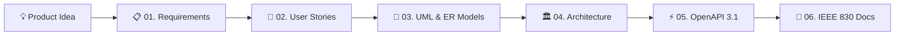

# 🚀 SEOS — Software Engineering Operating System

<div align="center">


**An AI-Powered Connected Engineering Workspace keeping requirements, domain models, architecture, APIs, and living documentation synchronized through a single canonical project model.**

*Developed for Thapar Institute of Engineering & Technology (TIET) — UCS 503 Coursework.*

---

[🌐 Live Backend API](https://seos-backend.onrender.com) • [📖 Interactive Swagger Docs](https://seos-backend.onrender.com/docs) • [💻 Frontend Repository](https://github.com/hashfydr/SEOS)

</div>

---

## 📌 Table of Contents
- [Overview](#-overview)
- [How It Works](#-how-it-works)
- [Core Modules](#-core-modules)
- [Enterprise & Academic Features](#-enterprise--academic-features)
- [Repository Structure](#-repository-structure)
- [Quickstart & Running Locally](#-quickstart--running-locally)
- [Cloud Deployment](#-cloud-deployment)
- [Automated Test Suite](#-automated-test-suite)
- [Technology Stack](#-technology-stack)
- [License](#-license)

---

## 💡 Overview

**SEOS** (Software Engineering Operating System) solves the critical **artifact-drift problem** in modern software engineering.

In traditional software development, requirements documents, Agile backlogs, UML diagrams, architectural blueprints, and API contracts are authored across isolated, disconnected tools (Jira, Lucidchart, Swagger, Confluence). When any single component changes, downstream deliverables inevitably drift out of sync, introducing compounding technical debt and implementation bugs.

**SEOS enforces a Single Source of Truth across the entire engineering lifecycle:**
When you input a product concept or modify an artifact, SEOS’s connected pipeline autonomously derives and propagates updates across every phase in real time.



---

## ⚙️ How It Works

1. **Idea Ingestion**: Enter a high-level product concept or software feature request in natural language.
2. **Autonomous Decomposition**: The AI pipeline derives verifiable IEEE 830 functional/non-functional requirements and Agile user stories.
3. **Structural Modeling**: Generates domain entities, primary/foreign keys, and relational cardinalities into interactive visual diagrams.
4. **System Architecture**: Automatically evaluates project scale to recommend optimal architectural patterns (Clean Architecture, Modular Monolith, Event-Driven Microservices).
5. **Contract Derivation**: Synthesizes production-ready OpenAPI 3.1 specifications directly from domain models.
6. **Documentation Synthesis**: Compiles a living, publication-ready Software Requirements Specification (SRS).

---

## 🧩 Core Modules

| Module | Identifier | Description | Key Capabilities |
| :--- | :---: | :--- | :--- |
| **Requirements Engineering** | `01/REQ` | Natural language requirement analysis & decomposition. | • IEEE 830 Structured Elicitation<br>• Priority tagging (`Critical`, `High`, `Med`, `Low`)<br>• Approval lifecycle (`Draft`, `Approved`, `Rejected`) |
| **Agile User Stories** | `02/STORY` | Traceable sprint backlog generation. | • Standard `As a... I want... So that...` format<br>• Gherkin `Given / When / Then` acceptance criteria<br>• Bidirectional mapping to requirement IDs |
| **System Modeling** | `03/UML` | Interactive UML & Entity-Relationship designer. | • Visual canvas for node-and-edge diagramming<br>• Automated relational inference (`1:1`, `1:N`, `N:M`)<br>• Real-time synchronization with API models |
| **Architecture Recommender** | `04/ARCH` | Scalability & system pattern engine. | • Architectural pattern recommendations<br>• Component-to-tech stack mapping<br>• Latency, operational cost, and complexity trade-offs |
| **API Designer** | `05/API` | OpenAPI 3.1 contract synthesizer & reverse parser. | • Complete OpenAPI 3.1 YAML generation<br>• Bidirectional reverse parser (YAML ➔ UML Models)<br>• Coursework validation against academic standards |
| **Living Documentation** | `06/DOCS` | Living specification & multi-format exporter. | • Full IEEE 830 SRS compiler<br>• Markdown export (`.md`)<br>• Executive printable PDF export (`.pdf`) |

---

## 🎓 Enterprise & Academic Features

### 🔐 3-Role Access Control (RBAC)
* **Solo Developer (`solo_dev`)**: Individual workspace. Build projects with local client persistence or optional cloud database sync.
* **Student (`student`)**: Cohort-based engineering workspace. Join course cohorts using institutional join codes (e.g. `UCS503-FALL26`) with automatic mentor milestone visibility.
* **Mentor / Faculty (`mentor`)**: Faculty workspace protected by verification passcode. Inspect live student audit rosters (mastery %, readiness status) and manage course cohorts.

### 📚 Document Upload & Grounded RAG
* **Multi-Format Ingestion**: Upload custom `.pdf`, `.md`, or `.txt` course syllabi and engineering documents.
* **Semantic Retrieval**: Text chunked with `pypdf` and indexed into the local retriever.
* **Dual-Layer Citations**: Inline citations ground AI recommendations against canonical software engineering literature (*Sommerville*, *Kleppmann*, *Martin*, *Evans*) and custom uploaded course notes.

### 🔄 Real-Time Database Persistence
* **Zero Data Loss**: Eliminates reliance on volatile browser cache with resilient SQLite/PostgreSQL cloud syncing.
* **1.5s Debounced Auto-Save**: Seamless background sync saves every keystroke and diagram edit.
* **Sync Health Indicators**: Real-time status badges (`● SAVED`, `↑ SYNCING`, `○ OFFLINE`) inform users of their data state.

---

## 📂 Repository Structure

```text
SEOS/
├── seos-app/                   # React 19 Frontend (Vite + TypeScript + Tailwind)
│   ├── src/
│   │   ├── components/         # Modals, sidebars, progress indicators, logo
│   │   ├── views/              # Core module screens (Requirements, Stories, UML, etc.)
│   │   ├── lib/                # LLM client, API client, RAG knowledge base, parsers
│   │   ├── store.ts            # Zustand global reactive state & persistence
│   │   └── types.ts            # Canonical data models & TypeScript definitions
│   ├── vercel.json             # Vercel deployment & API proxy configuration
│   └── package.json
│
├── backend/                    # FastAPI Backend REST Gateway (Python 3.11+)
│   ├── app/
│   │   ├── routers/            # Auth, Projects, Artifacts, Knowledge RAG, Classrooms
│   │   ├── models/             # SQLAlchemy ORM models
│   │   ├── schemas/            # Pydantic v2 validation schemas
│   │   ├── database.py         # Resilient DB engine (Postgres + SQLite fallback)
│   │   └── main.py             # FastAPI entrypoint, CORS, security middlewares
│   ├── alembic/                # Database migrations
│   ├── tests/                  # Pytest test suite (JWT, RBAC, load, disaster recovery)
│   ├── requirements.txt        # Python dependencies
│   └── Dockerfile              # Container specification
│
├── diagrams/                   # Architectural blueprints, DFDs, ERDs, LaTeX specs
├── scripts/                    # Disaster recovery drills and automation scripts
├── docker-compose.yml          # Local multi-service orchestration (Postgres + Backend + App)
├── start.sh                    # One-command dual-process launcher
└── README.md
```

---

## 🚀 Quickstart & Running Locally

### Option 1: One-Command Startup (Recommended)

Run the included automated launch script from the project root:

```bash
chmod +x start.sh
./start.sh
```

*This automatically boots the FastAPI backend on port `8000`, installs npm dependencies, launches Vite on port `5173`, and gracefully shuts down all processes on `Ctrl+C`.*

---

### Option 2: Manual Setup (Two Terminals)

#### Terminal 1 — Backend (FastAPI):
```bash
cd backend
python3 -m venv .venv
source .venv/bin/activate
pip install -r requirements.txt
uvicorn app.main:app --host 127.0.0.1 --port 8000 --reload
```
* Interactive API Docs: [http://127.0.0.1:8000/docs](http://127.0.0.1:8000/docs)

#### Terminal 2 — Frontend (Vite + React):
```bash
cd seos-app
npm install
npm run dev
```
* Web Application: [http://localhost:5173](http://localhost:5173)

---

### Option 3: Docker Compose

To spin up the entire production environment (PostgreSQL database, FastAPI backend, and Nginx frontend):

```bash
docker compose up -d
```
* **Frontend**: `http://localhost:3000`
* **Backend API**: `http://localhost:8000`

---

## 🌐 Cloud Deployment

SEOS uses a decoupled cloud architecture:

| Component | Platform | URL | Configuration |
| :--- | :--- | :--- | :--- |
| **Frontend** | **Vercel** | `https://seos.vercel.app` | Configured via `seos-app/vercel.json` with API rewrites |
| **Backend API** | **Render** | `https://seos-backend.onrender.com` | FastAPI running Python 3 with Uvicorn |
| **Database** | **Cloud / SQLite** | Integrated with auto-failover | Resilient persistence with debounced sync |

---

## 🧪 Automated Test Suite

SEOS includes comprehensive test coverage across both frontend and backend layers:

```bash
# 1. Frontend Unit & State Store Tests (Vitest)
cd seos-app && npm test

# 2. TypeScript Type Check & Production Build
cd seos-app && npm run build

# 3. Backend Integration, Auth & Concurrency Tests (Pytest)
cd backend && pytest
```

---

## 🛠️ Technology Stack

* **Frontend**: React 19, TypeScript, Vite 8, Tailwind CSS v4, Zustand, Lucide Icons
* **Backend**: FastAPI 0.115, Python 3.11+, SQLAlchemy 2.0, Pydantic v2, PyPDF, PyJWT, Cryptography
* **Databases**: SQLite (default local) / PostgreSQL (production) with SQLAlchemy connection pooling
* **Standards & Formats**: IEEE 830 (SRS), OpenAPI 3.1, Gherkin BDD syntax, Mermaid.js
* **DevOps & Cloud**: Docker, Docker Compose, Vercel, Render, GitHub Actions CI

---

## 📄 License

Distributed under the **MIT License**. See `LICENSE` for details.

*Authored by Harshit ([@hashfydr](https://github.com/hashfydr)) for TIET Coursework.*
