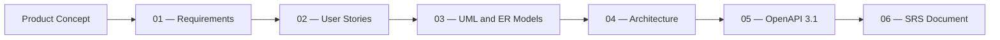

# SEOS — Software Engineering Operating System

<div align="center">


**An AI-powered connected engineering workspace that keeps requirements, domain models, architecture decisions, API contracts, and living documentation synchronized through a single canonical project model.**

*Developed for Thapar Institute of Engineering and Technology (TIET) — UCS 503: Software Engineering.*

---

[Live Application](https://seos-seos4.vercel.app) &nbsp;|&nbsp; [REST API](https://seos-backend.onrender.com) &nbsp;|&nbsp; [API Documentation](https://seos-backend.onrender.com/docs) &nbsp;|&nbsp; [Repository](https://github.com/hashfydr/SEOS)

</div>

---

## Table of Contents

- [Overview](#overview)
- [How It Works](#how-it-works)
- [Core Modules](#core-modules)
- [Platform Capabilities](#platform-capabilities)
- [Repository Structure](#repository-structure)
- [Local Development](#local-development)
- [Deployment Architecture](#deployment-architecture)
- [Test Suite](#test-suite)
- [Technology Stack](#technology-stack)
- [Security](#security)
- [License](#license)

---

## Overview

SEOS addresses the **artifact-drift problem** endemic to conventional software engineering workflows.

In standard practice, requirements documents, Agile backlogs, UML diagrams, architectural blueprints, and API contracts are authored and maintained across disconnected platforms — Jira, Lucidchart, Swagger, Confluence, and others. When changes occur in one artifact, downstream deliverables rapidly drift out of synchronization, compounding technical debt and introducing implementation defects.

**SEOS enforces a single source of truth across the entire software development lifecycle.** When a user defines a product concept or modifies any artifact, the platform automatically derives and propagates consistent updates across all subsequent phases in real time.



---

## How It Works

1. **Concept Ingestion** — Enter a high-level product concept or feature request in natural language.
2. **Requirement Decomposition** — The system derives verifiable IEEE 830 functional and non-functional requirements, each with a unique identifier, priority classification, and approval lifecycle.
3. **Story Generation** — Traceable Agile user stories and Gherkin acceptance criteria are generated from requirements, maintaining bidirectional traceability links.
4. **Structural Modeling** — Domain entities, primary and foreign keys, and relational cardinalities are compiled into interactive UML class diagrams and ER diagrams.
5. **Architecture Recommendation** — Scale and latency constraints are evaluated to recommend the optimal architectural pattern (Clean Architecture, Modular Monolith, or Event-Driven Microservices).
6. **Contract Derivation** — Production-ready OpenAPI 3.1 specifications are synthesized directly from domain models, eliminating manual API documentation.
7. **Documentation Synthesis** — A living, publication-ready Software Requirements Specification (SRS) compliant with IEEE 830 is compiled from all upstream artifacts.

---

## Core Modules

| Module | Identifier | Description | Key Capabilities |
| :--- | :---: | :--- | :--- |
| Requirements Engineering | `01/REQ` | Natural language requirement analysis and decomposition. | IEEE 830 structured elicitation; priority tagging (Critical, High, Medium, Low); approval lifecycle (Draft, Approved, Rejected) |
| Agile User Stories | `02/STORY` | Traceable sprint backlog generation. | Standard "As a / I want / So that" format; Gherkin BDD acceptance criteria; bidirectional traceability to requirements |
| UML and ER Modeling | `03/MODEL` | Visual domain and data modeling. | Auto-generated class diagrams and ER diagrams; entity relationship cardinality; interactive Mermaid.js rendering |
| Architecture Design | `04/ARCH` | System architecture evaluation and recommendation. | Pattern matching (Clean, Monolith, Microservices); scalability analysis; component decomposition |
| API Specification | `05/API` | OpenAPI 3.1 contract synthesis. | Full endpoint, schema, and response specification; derived from domain model; exportable YAML |
| SRS Documentation | `06/DOCS` | Living IEEE 830 Software Requirements Specification. | Structured document synthesis; PDF export; version-consistent with upstream changes |

---

## Platform Capabilities

### Artificial Intelligence Integration

SEOS integrates with multiple large language model providers through the Vercel AI SDK. The active provider and model are user-configurable at runtime.

| Provider | Integration |
| :--- | :--- |
| Google Gemini | `@ai-sdk/google` |
| OpenAI GPT | `@ai-sdk/openai` |
| Anthropic Claude | `@ai-sdk/anthropic` |

API keys are entered through the application settings panel and stored locally in the browser. No keys are transmitted to or stored on the SEOS backend.

### Cloud Project Persistence

Authenticated users benefit from full cloud-backed project persistence:

- All six artifact layers are stored and versioned per user account on the backend.
- Projects are hydrated from the remote on sign-in and synchronized on every change via debounced background saves.
- Sync state is surfaced through clear UI indicators: `SAVED`, `SYNCING`, and `OFFLINE`.
- Project state is fully isolated per user account — signing out clears all local state before the next session loads.

### RAG Knowledge Base

A retrieval-augmented generation layer is embedded in the backend. Relevant software engineering domain knowledge is retrieved and injected as context into LLM prompts, improving the accuracy and standard-compliance of generated artifacts.

### Export

All artifacts support export:

- **PDF** — Full SRS document export with HTML-escaped content.
- **YAML** — OpenAPI 3.1 specification download.
- **Mermaid source** — Diagram markup for use in external tools.

---

## Repository Structure

```text
SEOS/
├── seos-app/                     # React 19 frontend (Vite + TypeScript + Tailwind CSS v4)
│   ├── src/
│   │   ├── components/           # Modals, sidebars, progress indicators, branding
│   │   ├── views/                # Module screens: Requirements, Stories, UML, Architecture, API, SRS
│   │   ├── lib/                  # LLM client, API client, RAG knowledge base, export utilities
│   │   ├── store.ts              # Zustand global reactive state and cloud sync
│   │   └── types.ts              # Canonical TypeScript data models
│   ├── vercel.json               # Vercel deployment configuration and security headers
│   └── package.json
│
├── backend/                      # FastAPI REST gateway (Python 3.11+)
│   ├── app/
│   │   ├── routers/              # Auth, Projects, Artifacts, Knowledge RAG
│   │   ├── models/               # SQLAlchemy ORM models
│   │   ├── schemas/              # Pydantic v2 request and response schemas
│   │   ├── database.py           # Resilient DB engine (PostgreSQL with SQLite fallback)
│   │   └── main.py               # FastAPI entrypoint, CORS policy, security middleware
│   ├── alembic/                  # Database migration scripts
│   ├── tests/                    # Pytest suite: auth, RBAC, concurrency, disaster recovery
│   ├── requirements.txt          # Python dependencies (pinned minimums)
│   └── Dockerfile
│
├── diagrams/                     # Architectural blueprints, DFDs, ERDs, LaTeX specifications
├── scripts/                      # Disaster recovery drills and automation utilities
├── docker-compose.yml            # Multi-service orchestration (PostgreSQL + Backend + App)
├── start.sh                      # Dual-process local startup script
└── README.md
```

---

## Local Development

### Prerequisites

- Node.js 20 or later
- Python 3.11 or later
- Git

### Option 1: Automated Startup (Recommended)

Run the included launch script from the project root. It starts the FastAPI backend on port `8000`, installs npm dependencies if absent, and launches the Vite development server on port `5173`. All processes are terminated cleanly on `Ctrl+C`.

```bash
chmod +x start.sh
./start.sh
```

### Option 2: Manual Setup

**Terminal 1 — Backend**

```bash
cd backend
python3 -m venv .venv
source .venv/bin/activate        # Windows: .venv\Scripts\activate
pip install -r requirements.txt
uvicorn app.main:app --host 127.0.0.1 --port 8000 --reload
```

The interactive API documentation will be available at `http://127.0.0.1:8000/docs`.

**Terminal 2 — Frontend**

```bash
cd seos-app
npm install
npm run dev
```

The web application will be available at `http://localhost:5173`.

### Option 3: Docker Compose

To run the complete stack including a PostgreSQL database instance:

```bash
docker compose up -d
```

| Service | URL |
| :--- | :--- |
| Frontend | `http://localhost:3000` |
| Backend API | `http://localhost:8000` |
| API Documentation | `http://localhost:8000/docs` |

---

## Deployment Architecture

SEOS uses a decoupled cloud deployment model. Both services are connected to the `main` branch of this repository and deploy automatically on every push.

| Component | Platform | URL |
| :--- | :--- | :--- |
| Frontend SPA | Vercel | https://seos-seos4.vercel.app |
| Backend REST API | Render | https://seos-backend.onrender.com |
| API Documentation | Render | https://seos-backend.onrender.com/docs |

**CI/CD:** GitHub Actions runs `validate-and-build` (TypeScript check, Vite build, Vitest) and `backend-validation` (Pytest, pip-audit) on every push to `main`. Deployment to Vercel and Render proceeds only after both jobs pass.

> **Note:** Render's free-tier instances spin down after a period of inactivity. The first request after a cold start may take up to 50 seconds while the instance restarts.

---

## Test Suite

SEOS maintains automated test coverage across both frontend and backend layers.

### Running Tests

```bash
# Frontend — unit tests and state store tests (Vitest)
cd seos-app && npm test

# Frontend — TypeScript type check and production build verification
cd seos-app && npm run build

# Frontend — static analysis (oxlint)
cd seos-app && npm run lint

# Backend — integration, authentication, and concurrency tests (Pytest)
cd backend && pytest

# Backend — test coverage report
cd backend && pytest --cov=app --cov-branch --cov-report=term-missing

# Backend — dependency vulnerability audit
cd backend && pip_audit
```

### Current Results

| Layer | Test Files | Tests | Coverage |
| :--- | :---: | :---: | :---: |
| Frontend (Vitest) | 11 | 71 passed | — |
| Backend (Pytest) | — | 43 passed | 83% branch |

### Test Coverage Areas (Backend)

- JWT authentication and token lifecycle
- Role-based access control (user and admin roles)
- Optimistic concurrency control (version conflict detection)
- Project isolation across user accounts
- Disaster recovery: database reconnection and failover
- Load handling: concurrent request correctness

---

## Technology Stack

| Category | Technologies |
| :--- | :--- |
| Frontend framework | React 19, TypeScript 6, Vite 8 |
| Styling | Tailwind CSS v4 |
| State management | Zustand 5 |
| AI SDK | Vercel AI SDK 7 (`@ai-sdk/google`, `@ai-sdk/openai`, `@ai-sdk/anthropic`) |
| Schema validation | Zod 4 |
| Backend framework | FastAPI 0.115, Python 3.11+ |
| ORM and migrations | SQLAlchemy 2.0, Alembic |
| Validation | Pydantic v2 |
| Authentication | PyJWT, Passlib (bcrypt), Cryptography |
| Databases | SQLite (local default), PostgreSQL (production) |
| Containerization | Docker, Docker Compose |
| Cloud hosting | Vercel (frontend), Render (backend) |
| CI/CD | GitHub Actions |
| Testing | Vitest, Pytest, pip-audit |
| Standards | IEEE 830 (SRS), OpenAPI 3.1, Gherkin BDD, Mermaid.js |

---

## Security

- **Content Security Policy** — enforced on all Vercel responses; allows only declared origins for scripts, styles, fonts, and API connections.
- **HTTP security headers** — `X-Frame-Options: DENY`, `X-Content-Type-Options: nosniff`, `Referrer-Policy: strict-origin-when-cross-origin`, `Permissions-Policy` on all frontend responses.
- **Authentication** — JWT-based with bcrypt password hashing; tokens are short-lived and scoped.
- **Project isolation** — user project state is fully cleared on sign-out before any new session loads, preventing cross-account data leakage.
- **Dependency auditing** — `npm audit` and `pip_audit` are run in CI on every build; zero known vulnerabilities at current HEAD.
- **PDF export** — all project content is HTML-escaped before writing to export documents, preventing stored XSS in print contexts.

---

## License

Distributed under the MIT License. See [`LICENSE`](./LICENSE) for details.

Authored by Harshit ([@hashfydr](https://github.com/hashfydr)) — TIET, UCS 503 Software Engineering Coursework.
